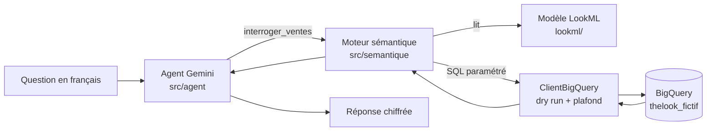

# Compagnon data : agent IA sur une couche sémantique LookML

Projet d'apprentissage personnel : un agent conversationnel qui répond en français à des questions sur des ventes (« Quel est le CA net des parfums en France en 2025 ? ») en interrogeant une **couche sémantique LookML** au-dessus de **BigQuery**, sans jamais écrire de SQL lui-même.

Toutes les données sont **fictives**, générées par script (marques, clients et chiffres inventés).

## Ce que montre le projet

- **Modélisation sémantique** : vues, mesures documentées, explores, refinements et explore dédié à l'IA en LookML.
- **Moteur sémantique** : traduction d'une requête (champs, filtres au format Looker, tris) en SQL BigQuery paramétré.
- **Agent IA** : Gemini sur Vertex AI, avec appel d'outils, mémoire de conversation et refus hors périmètre.
- **Recette des chiffres** : rapprochement systématique avec du SQL écrit à la main.
- **Industrialisation** : tests pytest, validateur LookML, CI GitHub Actions.

## Architecture



Les garde-fous sont empilés à chaque niveau :

| Niveau | Garde-fou |
| --- | --- |
| Agent | consignes (pas de chiffre inventé, refus hors périmètre), 8 appels d'outils maximum |
| Explore `ventes_ia` | seuls les champs utiles sont exposés, données personnelles masquées |
| Moteur | champs masqués refusés, filtres validés, valeurs passées en paramètres SQL |
| Outil | 200 lignes maximum, erreurs renvoyées à l'agent pour qu'il se corrige |
| BigQuery | dry run avant exécution, refus au-delà de 1 Go |

## Structure

```
.
├── lookml/                     modèle sémantique
│   ├── manifest.lkml           constantes projet GCP et dataset
│   ├── models/                 connexion, explores, tests LookML
│   ├── views/                  order_items, orders, products, users
│   └── refinements/ia.lkml     descriptions et explore pour l'agent
├── src/
│   ├── clients/                clients BigQuery et météo (API REST)
│   ├── semantique/             moteur LookML -> SQL et client « façon looker-sdk »
│   ├── agent/                  outils et agent Gemini
│   └── modeles/                classes métier d'exemple
├── scripts/
│   ├── generer_thelook.py      génère les données fictives (2 ans glissants)
│   ├── charger_bigquery.py     crée le dataset et charge les tables
│   └── valider_lookml.py       validateur LookML local
├── tests/                      tests pytest (moteur, outils, LookML, SQL, recette)
├── exercices/                  exercices d'apprentissage Python par jour
├── agent_jour7.py              lancer l'agent
└── .github/workflows/ci.yml    intégration continue
```

## Installation

Prérequis : Python 3.12, le Google Cloud CLI et un projet GCP avec BigQuery et Vertex AI activés.

```bash
git clone git@github.com:<utilisateur>/tutoloreal.git
cd tutoloreal
python -m venv .venv
source .venv/bin/activate
pip install -r requirements.txt

gcloud auth application-default login
```

Crée un fichier `.env` à la racine (il est ignoré par Git) :

```
GCP_PROJECT=<ton-projet-gcp>
GOOGLE_GENAI_USE_VERTEXAI=true
GOOGLE_CLOUD_PROJECT=<ton-projet-gcp>
GOOGLE_CLOUD_LOCATION=global
GEMINI_MODEL=<modele-gemini-flash>
```

Adapte aussi la constante `projet_gcp` dans `lookml/manifest.lkml`.

## Utilisation

```bash
# 1. Générer et charger les données fictives
python scripts/generer_thelook.py
python scripts/charger_bigquery.py

# 2. Valider le modèle LookML (avec vérification des tables et colonnes)
python scripts/valider_lookml.py --bigquery

# 3. Interroger le modèle sémantique
python livrable_jour6.py

# 4. Discuter avec l'agent
python agent_jour7.py            # conversation
python agent_jour7.py --eval     # jeu de questions de test
```

Exemple de conversation :

```
Vous : Quel est le CA net des parfums en France en 2025 ?
   [outil] interroger_ventes({"champs": ["order_items.ca_net"], "filtres_json": "{\"order_items.created_year\": \"2025\", \"products.category\": \"Parfums\", \"users.country\": \"France\"}"}) -> 1 ligne(s)
Compagnon : En 2025, le CA net des Parfums en France s'élève à 153 192 €.
```

## Tests et intégration continue

```bash
pytest -m "not bigquery"     # tests rapides, sans accès cloud
pytest -m bigquery           # recette : moteur comparé à du SQL de référence
```

La CI GitHub Actions s'exécute à chaque pull request et contrôle trois niveaux :

| Niveau | Contrôle | Détecte |
| --- | --- | --- |
| LookML | `valider_lookml.py` | syntaxe, références `${...}`, jointures, champs exposés |
| SQL | `tests/test_sql_valide.py` | SQL généré invalide (jointure incomplète, etc.) |
| Logique | `tests/test_moteur.py`, `tests/test_outils.py` | régressions du moteur et de l'agent, injection SQL |

La recette contre les vraies données (`-m bigquery`) se lance en local.

## Enseignements

1. **Un modèle syntaxiquement parfait peut donner un chiffre faux.** Une valeur de filtre erronée gonflait le CA net de 29 % : seul le rapprochement avec un calcul indépendant l'a révélé.
2. **Un agent se corrige surtout dans la couche sémantique.** Lister les valeurs possibles dans les descriptions et exposer le bon champ a suffi à corriger ses erreurs, sans modifier le code Python.
3. **Un LLM varie d'une exécution à l'autre.** Ce qui doit être garanti passe par le code (catalogue des champs injecté, garde-fous), pas par une consigne.

## Limites

Le moteur sémantique est volontairement simplifié par rapport à Looker : pas de *symmetric aggregates*, pas de *derived tables*, pas de *liquid*, pas de gestion des fuseaux horaires. Il sert à comprendre ce que fait une couche sémantique, pas à la remplacer.
